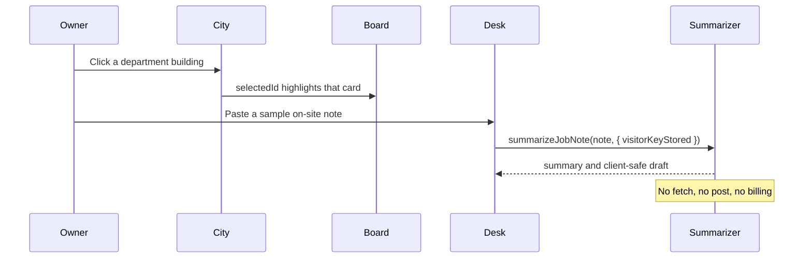

# Design Document

## Overview

Night-Shift Dispatch is a single-page Vite app. React holds one piece of UI state for the selected department and one piece for the sample-night beat. The 3D city, the dispatch board, and the job-note desk read that state. The summarizer is a pure function with no I/O.

Nothing in this build opens a network call. The optional visitor key is a `localStorage` flag path: the summarizer receives a boolean (`visitorKeyStored`), never the key string.

## Architecture

```text
index.html
  src/main.tsx
    src/App.tsx
      NightCity          sample roster + selected id
      DispatchBoard      same roster + activity log
      JobNoteDesk        textarea + summarizeJobNote()
        localStorage     visitor key only, browser only
```



## Technology

- Node 22, npm, Vite, TypeScript, React
- Three.js through `@react-three/fiber` and `@react-three/drei`
- Vitest for the summarizer
- CSS in one stylesheet, system fonts only
- Procedural meshes only (boxes, cones, spheres). No downloaded models, textures, or brand marks

## Components

### Night city

`NightCity` mounts a React Three Fiber `Canvas` when WebGL exists. Each department is a building group: body, roof, a few window boxes, and a point light colored by status. `OrbitControls` orbit the lot. Clicking a building calls `onSelect(id)`. Clicking the ground clears the selection.

An error boundary and a WebGL probe both fall back to `LotFallback`, a row of buttons with the same ids. The board and desk do not depend on the canvas.

Status colors:

| Status | Meaning | Light |
| --- | --- | --- |
| idle | Quiet this beat | cool slate |
| working | In the sample task | warm amber |
| waiting | Needs a human yes | pumpkin |

### Dispatch board

`DispatchBoard` renders one card per department and the activity log for the current sample beat. The selected card uses a border and an "On the lot" label, not color alone. Log lines for the selected department are marked.

"Step sample night" cycles a canned array in `sampleRoster.ts`. It only changes local React state.

### Job-note desk

`JobNoteDesk` holds the textarea, runs `summarizeJobNote`, and offers the built-in sample note. Copy uses the clipboard API and falls back to selecting the draft text. Failures stay on the page.

The visitor key field is `type="password"`. Save writes `hollow-pines.night-shift.visitor-key`. Clear removes that item. After save, the input is emptied. The key is never interpolated into the summary, the draft, or `console`.

### Summarizer

`summarizeJobNote(note, options)` in `src/summarizer/summarizeNote.ts`:

1. Collapse whitespace. Empty input returns a prompt and an empty draft.
2. Split sentences. Drop sentences that look internal (`internal:`, "do not tell", "our fault", and similar cues) from the client draft.
3. Redact a short list of insult and legal-threat words if they appear in owner-facing text that is still shown.
4. Pick a topic from home-repair keywords (plumbing, heating, electrical, roof and gutter, carpentry, otherwise "home repair").
5. Pick a follow-up line from "human yes", return-visit, or finished cues.
6. Build a short owner summary from the first safe sentences plus the follow-up.
7. Build a client-safe draft in Hollow Pines voice. It asks a person to confirm before the wording goes further.
8. If `visitorKeyStored` is true, set `notice` to say the key stayed in the browser and nothing was sent. Summary and draft text do not change based on that flag.
9. `sent` is always `false`.

The function has no `fetch`, storage, or clock dependency, so tests are deterministic.

## Data model

```ts
type AgentStatus = "idle" | "working" | "waiting";

interface Department {
  id: string;
  name: string;
  building: string;
  role: string;
  blurb: string;
  status: AgentStatus;
  statusNote: string;
  position: [number, number, number];
  footprint: [number, number];
  height: number;
  body: string;
}

interface ActivityEvent {
  id: string;
  at: string;
  departmentId: string;
  summary: string;
}

interface SampleBeat {
  label: string;
  statuses: Record<string, AgentStatus>;
  notes: Record<string, string>;
  log: ActivityEvent[];
}

interface JobNoteSummary {
  summary: string;
  clientDraft: string;
  topic: string;
  followUp: string;
  sent: false;
  notice: string;
}
```

Sample beats, departments, and the desk's sample note live in `src/data/sampleRoster.ts`. Tests keep their own fixtures.

## Error handling

| Case | Behavior |
| --- | --- |
| Empty note | Prompt, empty draft, no invented status |
| Internal sentence | Omitted from the client draft |
| WebGL missing or canvas error | Flat lot fallback; board and desk remain |
| `localStorage` throws | Summarizer still runs; desk explains the key was not stored |
| Clipboard denied | Draft stays visible and selected when possible |

## Testing

Vitest runs `src/summarizer/summarizeNote.test.ts` in Node, with no DOM and no network.

Covered cases: empty input, determinism, a shorter summary than a long note, internal wording kept out of the draft, insult redaction, and a stored-key flag that does not change the words or set `sent`.

`npm run build` is `tsc --noEmit && vite build` and must pass on Node 22.

`npm run guard` checks that `.env` is ignored and `/.kiro` is not ignored and is tracked.

## Out of scope for this build

- A real provider call, even if a visitor key is present
- Accounts, billing, backends, or persistence beyond `localStorage`
- More than the six sample departments
- Deploying or changing repository visibility
